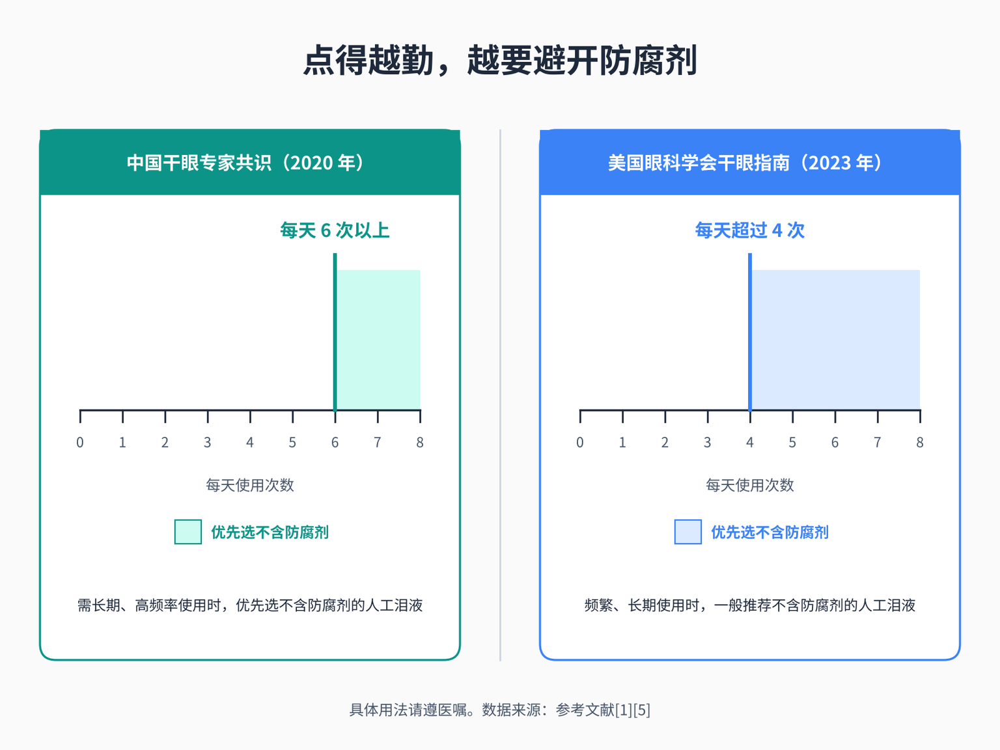
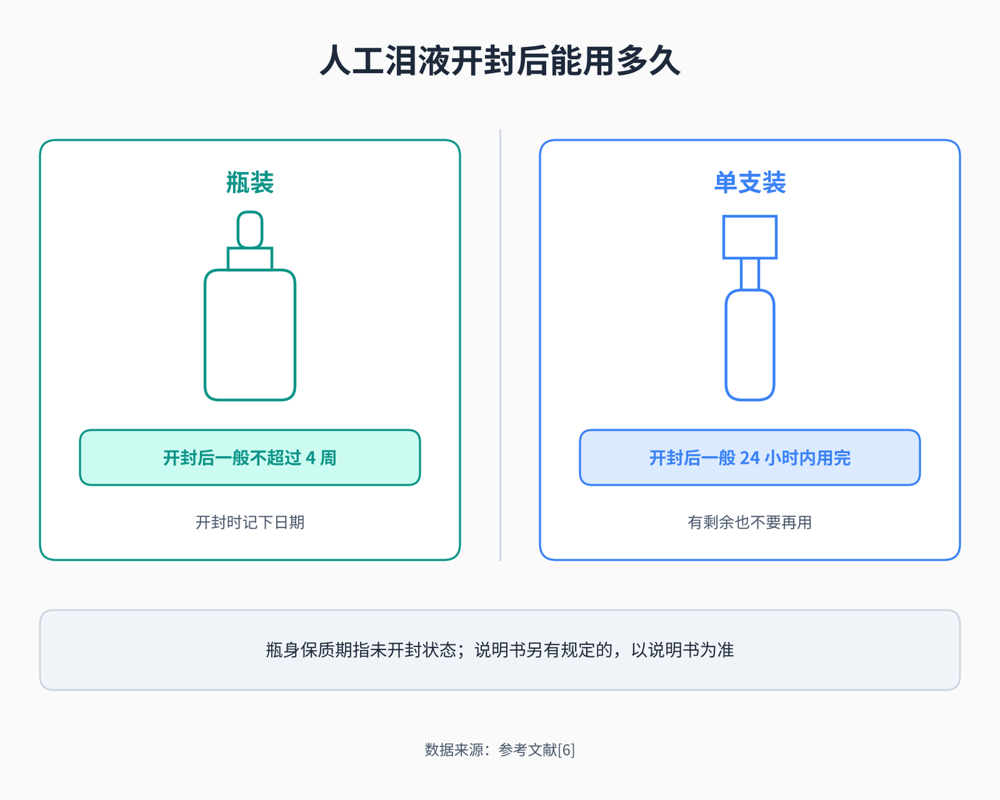

# 人工泪液能天天点吗，会不会越点越依赖

> 这是函哥整理的干眼常见问题。人工泪液可能是干眼人最熟悉的一瓶药，也是被问得最多的一瓶：能不能天天点？点久了会不会离不开？带防腐剂的要不要紧？开了封能放多久？下面这些回答，依据中国干眼专家共识、国际泪膜与眼表协会的最新治疗报告、美国眼科学会的干眼指南和系统评价，一个一个摆清楚。

**读者问：** 人工泪液到底是什么，和自己的眼泪一样吗？

**函哥答：** 人工泪液是模仿泪液成分、用来润滑眼表的滴眼液，能缓解不适，但它和真正的眼泪并不一样。

人工泪液在英文里叫 **Artificial Tears（人工泪液）**，国际报告里也常把这类产品称作泪液补充剂。中国干眼专家共识把它定位为**治疗干眼的一线用药**，主要作用是润滑眼表，属于对症治疗，各种类型的干眼都可以用 [1]。

它为什么不等于眼泪？国际泪膜与眼表协会的治疗报告说得很直接：这类产品是照着泪膜成分设计的，**但缺少天然泪液里那些有生物活性的成分** [2]。所以它能帮眼表“补水、润滑”，却替代不了眼睛自己分泌的泪液。

按作用，人工泪液大致分两类 [1]：

- **补充水液层的**：主要补水、润滑，常见成分有玻璃酸钠、羧甲基纤维素、羟丙基甲基纤维素、聚乙烯醇、聚乙二醇、聚丙烯酸等。
- **补充脂质层的**：含脂类成分或模拟脂质结构，主要减少泪液蒸发、让泪膜更稳定。

**读者问：** 人工泪液可以天天点、长期点吗？

**函哥答：** 可以。干眼本来就需要长期管理，天天用人工泪液是常见做法，关键是选对类型、用对频率。

中国干眼专家共识写明，干眼的治疗原则是**根据类型和程度给予长期和个体化治疗** [1]。人工泪液作为一线用药，长期使用是这个思路里的一部分。

安全性方面，一项纳入 43 个随机对照试验、共 3497 名干眼患者的 Cochrane 系统评价认为，非处方人工泪液**总体上可能是安全的，但并非完全没有不良反应**；同时作者也提醒，纳入研究的质量偏低，证据还不够扎实 [3]。

所以“能不能天天点”的答案是能，但“天天点”不等于“随便点”。后面几个问题讲的防腐剂、频率、开封时间，就是“用对”的具体内容。

**读者问：** 点久了会不会产生依赖，越点越离不开？

**函哥答：** 人工泪液的作用是润滑眼表、缓解症状，停了又难受，通常说明干眼本身还在，问题要回到找原因上。

中国干眼专家共识对干眼的定义是：**多因素引起的慢性眼表疾病**，泪液的质、量或动力学异常，导致泪膜不稳定或眼表微环境失衡 [4]。人工泪液是对症治疗 [1]，它缓解的是“干”的感觉，并不处理让眼睛变干的原因。

这就好比天气干的时候抹润肤霜：抹了舒服，停了又干，是因为让皮肤缺水的原因还在。

真正要做的是，在医生帮助下尽量把诱因找出来。共识提出干眼的治疗目标是**缓解症状，保护视功能，尽可能去除病因**，并且治疗要从易到难，首先针对已知的相关因素 [1]。美国眼科学会指南的第一步，也包括调整周围环境、识别并在可能时调整会引起干眼的全身用药和眼部用药、眼睑清洁和热敷等 [5]。

**读者问：** 含防腐剂和不含防腐剂的人工泪液，差别在哪？

**函哥答：** 防腐剂是为了防止药水开封后被细菌污染，但有的防腐剂本身会刺激眼表，需要长期、频繁点的人更适合不含防腐剂的。

国际泪膜与眼表协会的治疗报告提到，人工泪液里常用的防腐剂包括苯扎氯铵和乙二胺四乙酸，作用是防止药水被细菌污染；但**苯扎氯铵这类防腐剂可能对眼表产生毒性和促炎作用，反而加重干眼的症状和体征** [2]。

正因为这样，人工泪液的发展方向主要有三条 [2]：

| 做法 | 怎么解决污染问题 |
|---|---|
| 不含防腐剂的单剂量包装 | 一支只用一次，不需要防腐剂 |
| 换用刺激更小的防腐剂 | 保留防腐，但减少对眼表的伤害 |
| 不含防腐剂的多剂量瓶 | 瓶子本身经过专门设计，防止微生物污染 |

这并不是说含防腐剂的人工泪液都不能用。美国眼科学会指南认为，**对轻度干眼、眼表其他方面健康的人，含防腐剂的人工泪液可能就够用** [5]。差别主要在于用得多不多、用得久不久，下一问会讲到具体频率。

**读者问：** 单支装的人工泪液，一支一支的，有什么特别意义？

**函哥答：** 单支装通常就是为了做到不含防腐剂，代价是一支只能用一次，开了就要尽快用完。

前面说过，不含防腐剂的单剂量包装是减少防腐剂刺激的一种做法 [2]。没有防腐剂，开封后就没有东西帮它“防污染”，所以只能一次性使用。

健康中国发布的护眼辟谣科普提醒：**单支装的眼药水开封后，一般要在 24 小时内用完，即便有剩余也不能再继续用** [6]。具体的使用时限，以说明书为准。

如果需要每天点很多次、又嫌单支装不方便，也可以问问医生或药师有没有不含防腐剂的多剂量瓶装产品 [2]。

**读者问：** 人工泪液一天点几次合适？

**函哥答：** 没有一个人人都适用的次数，一般轻度干眼每天 4 次左右，较重时可以增加或按需使用，点得越频繁越要选不含防腐剂的。

中国干眼专家共识按干眼程度给出了参考 [1]：

- **轻度干眼**：选黏稠度较低的人工泪液，每天 4 次。
- **中、重度干眼**：选黏稠度较高的人工泪液，次数根据病情和症状适当增加，或按需使用。
- 不同人工泪液可以组合使用，比如高黏稠度和低黏稠度的搭配。
- **眼用凝胶、膏剂**在眼表停留时间长，主要用于重度干眼，但会让视物模糊，可以选在睡前用。

关于“点多少次以上该换成不含防腐剂的”，国内外的说法不完全一样：

| | 什么情况下优先选不含防腐剂的 |
|---|---|
| 中国干眼专家共识（2020 年）[1] | 需要长期、高频率使用，**如每天 6 次以上** |
| 美国眼科学会干眼指南（2023 年）[5] | 频繁、长期使用，**如每天超过 4 次** |

两份文件的方向是一致的：点得越勤、用得越久，越应该避开防腐剂。具体到自己，还是按眼科医生的建议来。

美国眼科学会指南还提到一个常见的取舍：**越黏稠的产品，效果维持越久，可能可以少点几次，但也更容易让视物模糊** [5]。白天要看书、开车的人，可以和医生商量白天、晚上用不同的类型。

**读者问：** 人工泪液开封以后能用多久？

**函哥答：** 以说明书为准；没有特别说明的瓶装眼药水，开封后一般不超过 4 周，单支装一般 24 小时内用完。

健康中国的辟谣科普讲了三点 [6]：

- **瓶身上的保质期是指未开封状态**，一旦开封，这个期限就不再适用了。
- **大多数瓶装眼药水开封后 4 周就可能被细菌污染**，继续使用容易引起结膜炎、角膜炎等问题，所以开封时最好记下日期，使用时间不要超过 4 周。
- **单支装开封后一般 24 小时内用完**，有剩余也不要再用。

文中也强调，眼药水的使用时间应严格遵循说明书的建议 [6]。有些产品的说明书会写不同的期限，按说明书来就行。

**读者问：** 市面上人工泪液那么多，该怎么选？

**函哥答：** 看自己的干眼类型和成分，不看广告；拿不准时让眼科医生帮着选。

中国干眼专家共识的选择原则是：根据**干眼的类型、程度，以及使用时的舒适度**个性化选择，选自己用着舒服、能坚持用的 [1]。其中有一条很实用：**睑板腺功能障碍这类脂质层出问题的干眼，优先选含脂质成分的人工泪液** [1]。

那哪一种最好？目前的证据回答不了。前面提到的 Cochrane 系统评价发现，**大多数非处方人工泪液的效果可能差不多**，只在少数两两比较里看到了差别，其余比较结果互相矛盾或没有差别，研究设计和报告也不一致，还不能对单个产品的效果下可靠结论 [3]。国际泪膜与眼表协会的报告也提到，患者选人工泪液常常要反复试，既费钱又让人沮丧 [2]。

所以挑人工泪液，可以先看这几件事：

1. 自己偏“泪水不够”还是“蒸发太快”，这需要眼科检查来判断 [1]；
2. 一天大概要点几次，决定要不要选不含防腐剂的 [1][5]；
3. 白天点完会不会糊，是否影响工作和开车 [5]；
4. 用一段时间后症状有没有改善。

**读者问：** 用了人工泪液，什么情况下该回医院复诊？

**函哥答：** 点了几周仍然不见好、越点越勤，或者出现眼痛、眼红、视力变化，都该去眼科。

英国国家医疗服务体系（NHS）建议，**自己处理几周后眼睛仍然干**，就该找专业人员看看；如果查不出原因，会转给眼科专科做检查 [7]。

这些情况要尽快就医，不要只靠多点几次人工泪液 [7]：

- **眼睛疼痛又发红**；戴隐形眼镜的人出现眼红，可能是眼部感染
- **视力出现变化**，比如看到波浪线、闪光，或者视力下降
- **看光就痛**
- 眼睛非常红，或者眼红同时伴有剧烈头痛、恶心
- 眼睛受伤，或有异物卡在眼里

复诊的意义不只是换一瓶药。人工泪液只是干眼治疗的第一步，美国眼科学会指南在第一步不够用时，会考虑改用不含防腐剂的润滑剂等后续措施，并强调睑缘炎、睑板腺炎这些相关的眼部问题也要一起处理 [5]；国内共识也强调要找出并处理相关病因 [1]。这些都需要眼科医生检查后决定，去眼科就可以。

人工泪液是干眼人的好帮手，天天点没问题，选对类型、注意防腐剂和开封时间就好；要是总也离不开，那就是时候让眼科医生帮你把背后的原因找出来了。

---

## 参考文献

[1] 亚洲干眼协会中国分会, 海峡两岸医药卫生交流协会眼科学专业委员会眼表与泪液病学组, 中国医师协会眼科医师分会眼表与干眼学组. [中国干眼专家共识：治疗（2020年）](https://training.yiigle.com/uploads/guide_html/%E4%B8%AD%E5%9B%BD%E5%B9%B2%E7%9C%BC%E4%B8%93%E5%AE%B6%E5%85%B1%E8%AF%86%EF%BC%9A%E6%B2%BB%E7%96%97%EF%BC%882020%E5%B9%B4%EF%BC%89.html). 中华眼科杂志, 2020, 56(12): 907-913. 专家共识，访问日期：2026-11-18.

[2] Jones L, Craig JP, Markoulli M, et al. [TFOS DEWS III: Management and Therapy](https://doi.org/10.1016/j.ajo.2025.05.039). American Journal of Ophthalmology, 2025, 279: 289-386. 国际专业报告，访问日期：2026-11-18.

[3] Pucker AD, Ng SM, Nichols JJ. [Over the counter (OTC) artificial tear drops for dry eye syndrome](https://pubmed.ncbi.nlm.nih.gov/26905373/). Cochrane Database of Systematic Reviews, 2016, (2): CD009729. 系统评价，访问日期：2026-11-18.

[4] 亚洲干眼协会中国分会, 海峡两岸医药卫生交流协会眼科学专业委员会眼表与泪液病学组, 中国医师协会眼科医师分会眼表与干眼学组. [中国干眼专家共识：定义和分类（2020年）](https://training.yiigle.com/uploads/guide_html/%E4%B8%AD%E5%9B%BD%E5%B9%B2%E7%9C%BC%E4%B8%93%E5%AE%B6%E5%85%B1%E8%AF%86%EF%BC%9A%E5%AE%9A%E4%B9%89%E5%92%8C%E5%88%86%E7%B1%BB%EF%BC%882020%E5%B9%B4%EF%BC%89.html). 中华眼科杂志, 2020, 56(6): 418-422. 专家共识，访问日期：2026-11-18.

[5] American Academy of Ophthalmology. [Dry Eye Syndrome Preferred Practice Pattern](https://aao.org/Assets/07558f65-8d1a-4b35-8350-3126f0d0fd01/638434228319570000/dry-eye-syndrome-ppp-pdf). 临床指南（2023 年），访问日期：2026-11-18.

[6] 王宁利. [谣言终结站丨这些护眼“偏方”千万别信！](https://www.news.cn/politics/20260526/27c27e41b270488fb43c7f1a86a05299/c.html). 新华网转载自健康中国, 2026-05-26. 公共卫生科普，访问日期：2026-11-18.

[7] NHS. [Dry eyes](https://www.nhs.uk/conditions/dry-eyes/). 公共卫生机构科普页面，访问日期：2026-11-18.

*本文为健康科普，按读者常见问题整理，不能替代个人诊疗意见。人工泪液的选择和用法请咨询眼科医生或药师，并以药品说明书为准；出现眼痛、视力变化、明显怕光或眼外伤时请立即到医院眼科就诊。*
