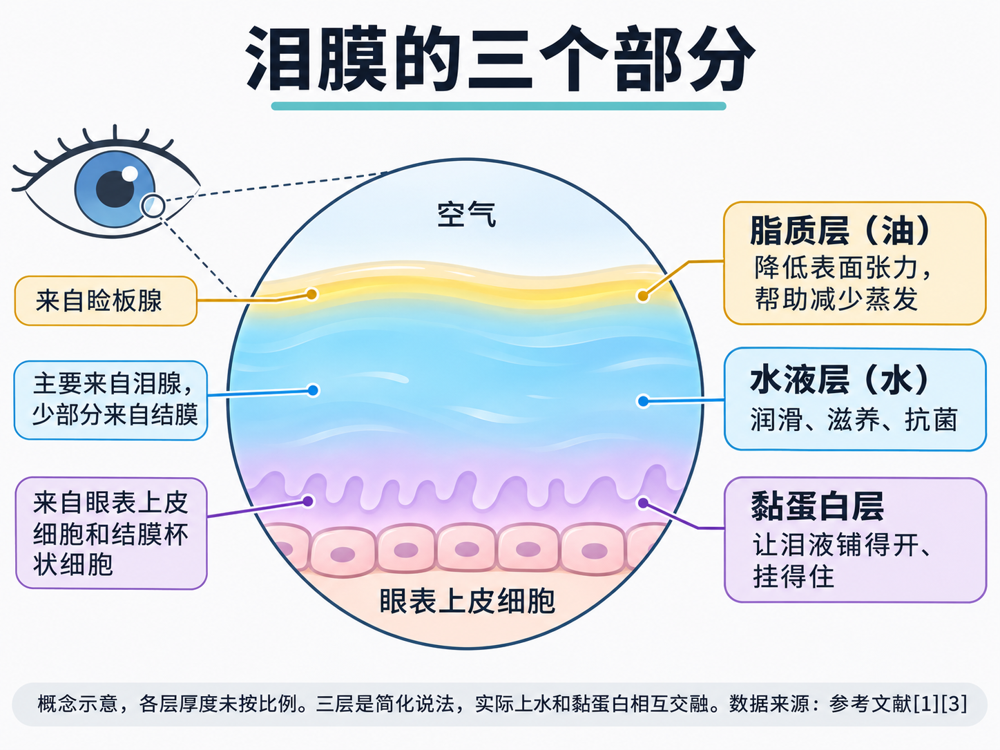
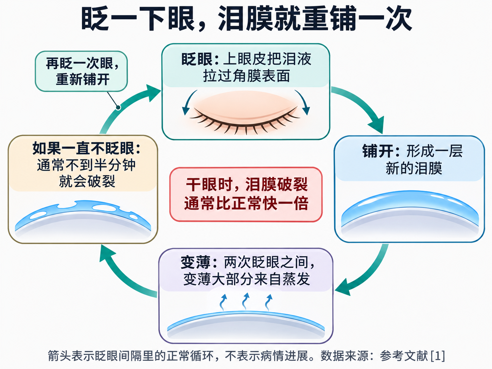
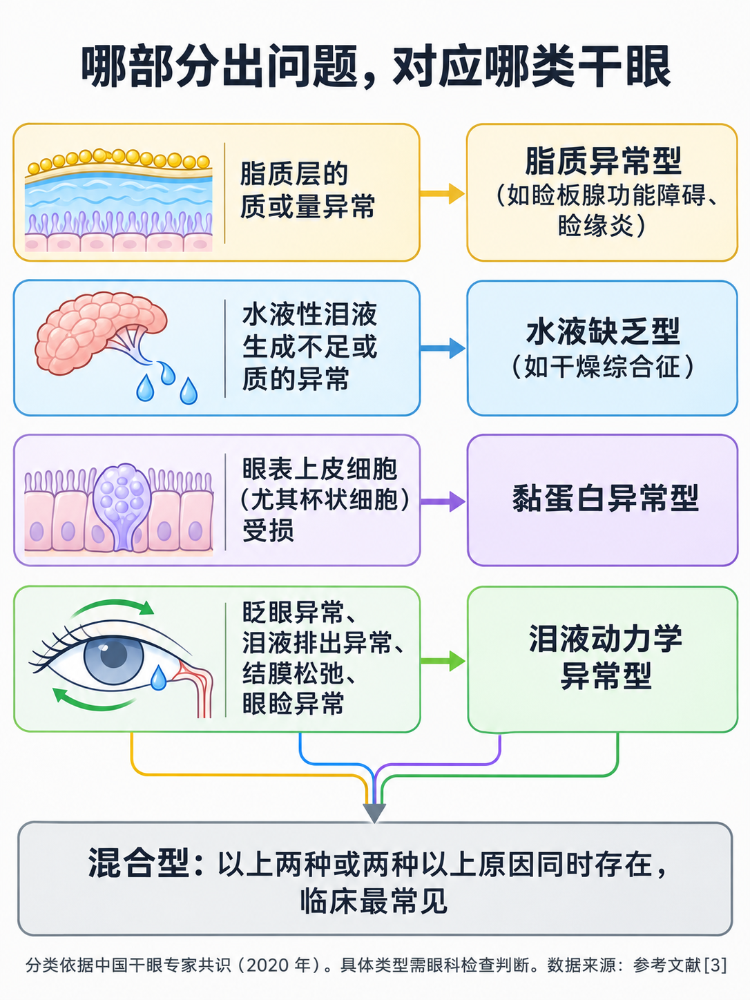

# 泪膜是什么：眼睛表面那层看不见的“保护膜”

> 很多人眼睛干，第一反应是“眼泪不够了”，于是多点几滴眼药水。可去医院一查，医生说的常常是“泪膜不稳定”。眼泪明明还在，怎么就不稳定了？这层“膜”到底是什么？函哥今天就把眼睛表面这层看不见的东西摆清楚，懂了它，很多干眼的道理就好理解了。

## 01 泪膜：铺在眼球表面的一层薄薄的液体

泪膜在英文里叫 **Tear Film（泪膜）**，指的是每次眨眼后，均匀铺在角膜和结膜表面的那一层泪液。

它有多薄？国际泪膜与眼表协会的泪膜报告提到，角膜表面的泪膜**大约只有 2~5.5 微米厚** [1]，用肉眼是看不见的。整只眼睛表面的泪液总量也很少，正常人**大约只有 8 微升左右** [1]。

量虽然少，活儿却不少。这层膜至少在做几件事 [1]：

- **润滑**：让眼皮和眼球之间顺滑，眨眼不磨。
- **滋养和保护**：给眼表细胞提供一部分营养，里面还有能抵御感染的抗菌蛋白和抗体。
- **保持合适的渗透压**：让眼表细胞待在一个“咸淡合适”的环境里。
- **帮你看清楚**：泪膜是光线进入眼睛时经过的**第一个折射面** [1]。

最后一点很多人没想到：泪膜不只是“湿润”的事，也和看东西清不清楚有关。视物模糊本身就是干眼常见的症状之一 [2]。

## 02 三层结构：油、水、黏蛋白各管一摊

中国干眼专家共识的说法是：**眼表泪膜主要由脂质层、水液层及黏蛋白层组成**，通过眨眼等泪液动力学过程把泪液分布到眼表，最后排出眼部 [3]。从外到内看：

**最外层：脂质层（一层油）**

- 来源：几乎全部来自睑板腺的分泌物 [1]。睑板腺就藏在上下眼皮里。
- 作用：降低泪膜表面的张力，一般认为还能帮忙**减少泪液蒸发** [1]。
- 厚度：报告里测到的厚度从 15 到 157 纳米不等，平均约 42 纳米 [1]，比整层泪膜还要薄得多。

**中间层：水液层（主体是水）**

- 来源：大部分由泪腺分泌，还有一小部分来自结膜 [1]。
- 作用：泪膜里的“水”，溶着蛋白质、电解质、抗菌成分等，负责润滑、滋养和保护眼表 [1]。

**最里层：黏蛋白层（贴着眼球的那一层）**

- 来源：一部分黏蛋白“长”在眼表上皮细胞表面；另一部分由结膜里的杯状细胞分泌 [1]。
- 作用：黏蛋白能结合水，**让泪液在眼球表面铺得开、挂得住** [1]。没有它，眼表就像一块不沾水的塑料板，水珠一滴上去就滚走了。它还能帮着把灰尘、病原体裹住，随眨眼清理掉 [1]。

> **你可能想问：** 泪膜真的像千层饼一样分得清清楚楚吗？其实不是。国际报告指出，“三层”是对实际情况的简化，泪膜更像一个整体运作的功能单元，水和黏蛋白之间是相互交融的，组成了泪膜的主体 [1]。分三层来讲，是为了方便理解每一部分出了问题会怎样。

## 03 眨一下眼，泪膜就重铺一次

泪膜不是一直静静地待在那里，它靠眨眼不停地“刷新”。

每次眨眼，上眼皮像刷子一样把一层泪液拉过角膜表面 [1]，铺好一层新的泪膜。接下来泪膜会慢慢变薄，**两次眨眼之间看到的变薄，大部分是蒸发造成的** [1]。如果一直不眨眼，人的泪膜**通常不到半分钟就会“破裂”** [1]，也就是表面开始出现干斑。

平时我们会不自觉地眨眼，每眨一次，新的泪膜就又铺上了。泪液也一直在更新，报告估算每分钟大约更新 16% [1]，泪液铺开之后，最后会排出眼部 [3]。

## 04 泪膜“不稳定”，眼睛为什么会干、会糊

现在回到开头那个问题：眼泪还在，怎么就“不稳定”了？

**泪膜不稳定，说的是这层膜维持不住、破得太快。** 报告提到，干眼患者的泪膜破裂时间**通常比正常人快一倍** [1]；干眼时泪液蒸发速度也会增加到大约两倍 [1]。泪膜变薄、蒸发加快，泪液就会变“浓”，医学上叫**渗透压升高** [1]。

国际泪膜与眼表协会 2025 年发布的最新干眼报告，对干眼的定义是：干眼是一种多因素的、有症状的疾病，特征是**泪膜和（或）眼表失去稳态**，其中泪膜不稳定和高渗透压、眼表炎症和损伤、神经感觉异常都是病因因素 [4]。中国干眼专家共识也把干眼定义为由泪液的质、量及动力学异常导致的**泪膜不稳定或眼表微环境失衡** [3]。

所以“眼睛干”不一定是“眼泪少”。**眼泪的量够不够、质量好不好、铺得匀不匀，任何一个环节出问题，都可能让泪膜不稳定。** 这时眼睛会出现干涩、异物感、烧灼、眼红，看东西也可能变模糊 [2]。

> **你可能想问：** 医院怎么知道我的泪膜稳不稳？最常用的是测“泪膜破裂时间”，就是眨眼后睁着眼，看泪膜多久开始出现破裂。国际最新报告建议优先用不接触眼睛的方法来测，低于 10 秒提示泪膜不稳定；如果是先滴荧光素染色再测，判断标准降到 5 秒 [4]。具体怎么查、结果怎么看，交给眼科医生。

## 05 哪一层出问题，干眼的类型就不一样

泪膜的三个部分，各自出问题，就对应不同类型的干眼。中国干眼专家共识按泪液成分和功能异常，把干眼分成五类 [3]：

| 类型 | 主要问题 | 常见原因举例 |
|---|---|---|
| 脂质异常型 | 脂质层的质或量异常 | 睑板腺功能障碍、睑缘炎等 |
| 水液缺乏型 | 水液性泪液生成不足或质的异常 | 干燥综合征和许多全身疾病 |
| 黏蛋白异常型 | 眼表上皮细胞（尤其杯状细胞）受损 | 各种损伤眼表的因素 |
| 泪液动力学异常型 | 泪液的分布和排出异常 | 眨眼变少或眨不完全、结膜松弛、眼睑异常等 |
| 混合型 | 以上两种或两种以上原因同时存在 | 临床最常见 |

国际最新报告的思路也类似：它认为**大多数干眼以蒸发过强为主**，并把干眼的病因分得更细，大致归为泪膜成分不足、眼睑异常和眼表异常几大类，以便更有针对性地治疗 [4]。

这也是为什么不同人的干眼，治法不一样。国际报告提到，补充泪液、稳定泪膜仍然是干眼治疗的主要手段，目前已经有分别针对脂质、水液、黏蛋白成分的药物和器械 [4]；眼睑问题、睑板腺功能障碍则需要从眼睑这一头入手 [4]。**到底是哪一层出了问题，需要眼科检查来判断**，不建议自己对号入座。

## 06 什么时候该去眼科

泪膜的问题，靠自己是看不出来的。如果自己调整了几周，眼睛还是干 [5]，或者眼干已经影响到日常生活 [2]，就该去看看。严重的干眼如果长期不治疗，有时会损伤角膜 [2]。

下面这些情况不要拖，尽快就医 [5]：

- 眼睛疼痛又发红；戴隐形眼镜的人眼红，可能是眼部感染
- 视力出现变化，比如看到波浪线、闪光，或者视力下降
- 看光就痛
- 眼睛受伤，或有异物卡在眼里

干眼的诊断和分型去**眼科**就可以。前面提到干燥综合征等全身疾病也会引起水液缺乏型干眼 [3]，如果眼干的同时还有口干等其他不适，就诊时一并告诉医生，由医生判断要不要进一步检查。

泪膜很薄，却是眼睛表面的第一道防线；下次再觉得眼干，不妨先想想：是油不够、水不够，还是没好好眨眼。

---

## 参考文献

[1] Willcox MDP, Argüeso P, Georgiev GA, et al. [TFOS DEWS II Tear Film Report](https://pmc.ncbi.nlm.nih.gov/articles/PMC6035753/). The Ocular Surface, 2017, 15(3): 366-403. 国际专业报告，访问日期：2026-11-20.

[2] National Eye Institute. [Dry Eye](https://www.nei.nih.gov/learn-about-eye-health/eye-conditions-and-diseases/dry-eye). 公共卫生机构科普页面，访问日期：2026-11-20.

[3] 亚洲干眼协会中国分会, 海峡两岸医药卫生交流协会眼科学专业委员会眼表与泪液病学组, 中国医师协会眼科医师分会眼表与干眼学组. [中国干眼专家共识：定义和分类（2020年）](https://training.yiigle.com/uploads/guide_html/%E4%B8%AD%E5%9B%BD%E5%B9%B2%E7%9C%BC%E4%B8%93%E5%AE%B6%E5%85%B1%E8%AF%86%EF%BC%9A%E5%AE%9A%E4%B9%89%E5%92%8C%E5%88%86%E7%B1%BB%EF%BC%882020%E5%B9%B4%EF%BC%89.html). 中华眼科杂志, 2020, 56(6): 418-422. 专家共识，访问日期：2026-11-20.

[4] Perez VL, Chen W, Craig JP, et al. [TFOS DEWS III: Executive Summary](https://doi.org/10.1016/j.ajo.2025.09.035). American Journal of Ophthalmology, 2025. 国际专业报告（期刊预发表版本），访问日期：2026-11-20.

[5] NHS. [Dry eyes](https://www.nhs.uk/conditions/dry-eyes/). 公共卫生机构科普页面，访问日期：2026-11-20.

*本文为健康科普，不能替代个人诊疗意见。眼干反复或影响生活时请到正规医院眼科就诊；出现眼痛、视力突然下降、明显怕光时请尽快就医。*
