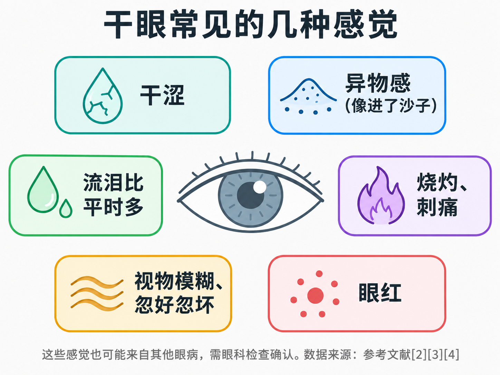
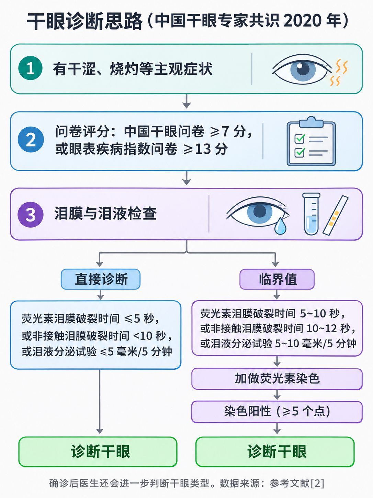

# 眼睛干涩、发红、像进了沙子，是不是得了干眼

> 这是函哥整理的干眼常见问题。眼睛干、红、磨得慌，很多人第一反应是“我是不是干眼了”。下面几个问题，回答依据国际泪膜与眼表协会的最新诊断报告、中国干眼专家共识和公共卫生机构的公开资料，帮你分清楚：哪些感觉像干眼，怎么确诊，什么时候该马上去医院。

**读者问：** 眼睛又干又红，还老觉得像进了沙子，这就是干眼吗？

**函哥答：** 有可能，但光凭这几种感觉还不能下结论，干眼要靠“有症状 + 检查发现泪膜或眼表异常”才能确诊。

先说说干眼到底是什么。**DED = Dry Eye Disease（干眼）**，国际泪膜与眼表协会在 2025 年发布的最新诊断报告里，把它定义为一种多因素的、有症状的疾病，核心是泪膜和（或）眼表失去了原本的平衡；泪膜不稳定、泪液渗透压升高、眼表炎症和损伤、神经感觉异常，都是它的成因 [1]。报告还特别强调：干眼是“病”，而且**一定是有症状的** [1]。

问题在于，干涩、发红、异物感这些感觉并不是干眼独有的。过敏、结膜炎、视疲劳、倒睫等情况都可能带来相似的不适，中国干眼专家共识专门把这些列为需要和干眼鉴别的情况 [2]。所以，“像进了沙子”只能说明眼表不舒服，至于是不是干眼，需要眼科医生检查后判断。

**读者问：** 干眼一般会有哪些感觉？

**函哥答：** 干眼的感觉很杂，不只是“干”，异物感、烧灼感、发红、看东西模糊忽好忽坏，甚至流泪都可能出现。

中国干眼专家共识列出的常见症状包括 [2]：

- 眼睛干涩感、异物感、烧灼感
- 眼痒、疼痛、眼红
- 视疲劳
- 视物模糊、视力波动

美国国家眼科研究所的科普也提到，干眼可能让人感觉眼里像有东西在磨，伴有刺痛或烧灼感、眼红、怕光和视物模糊 [3]。英国国家医疗服务体系（NHS）的说明里还有一条容易被忽略：**眼睛比平时更爱流泪**，也可能是干眼的表现 [4]。

所以，“我眼泪挺多的，应该不是干眼”这个想法不一定对。眼泪多不等于泪膜好，具体是哪种情况，还是要靠检查。

**读者问：** 那干眼和结膜炎、过敏、看久了眼疲劳，怎么区分？

**函哥答：** 自己只能大致区分，关键看伴随表现：痒得厉害多想到过敏，有黏稠分泌物多想到结膜炎，看近处久了酸胀多想到视疲劳，但最终要医生检查确认。

中国干眼专家共识给出了几种常见易混淆情况的区别，函哥把它整理成下表 [2]：

| 情况 | 常见原因 | 更典型的表现 | 医生可能做的检查 |
|---|---|---|---|
| 眼表过敏 | 接触过敏原 | **眼痒**、眼红，结膜充血，可有黏丝状分泌物 | 过敏原检查、结膜刮片 |
| 视疲劳 | 两眼度数相差较大（屈光参差）、调节功能异常 | 怕光、眼胀痛，但眼表体征很少 | 调节功能检查、全面验光 |
| 慢性结膜炎 | 结膜慢性炎症 | 结膜有渗出、乳头或滤泡，有时耳前淋巴结肿大 | 结膜刮片细胞学检查 |
| 角膜神经痛 | 角膜神经损伤等 | 症状明显，但查不到干眼的体征 | 共聚焦显微镜检查 |

另外，NHS 的结膜炎科普提到：结膜炎常常两只眼一起出现，眼红、烧灼或磨砂感、流泪，**有脓性分泌物粘在睫毛上**的多为细菌感染，过敏引起的结膜炎会让眼睛红、流泪，但不传染 [5]。

这几种情况还可能同时存在，比如过敏的人也可以有干眼。分不清时别自己乱点药，先去眼科。

**读者问：** 网上的干眼自测问卷，分数高是不是就能确诊了？

**函哥答：** 不能，问卷只是初步筛查，分数高说明值得去查，确诊还得靠检查结果。

国际报告推荐先用一份 6 个问题的简版眼表疾病指数问卷（OSDI-6）做筛查，**得分 ≥4 分算阳性**，阳性之后还要再看泪膜和眼表检查，至少一项异常才能诊断干眼 [1]。中国干眼专家共识也把问卷作为简便的初步评估手段，诊断时需要同时看客观检查指标 [2]。

问卷主要反映的是“你有多不舒服”。前面说过，过敏、结膜炎、视疲劳也会让人不舒服，所以问卷分数高并不能区分这些情况。

**读者问：** 去医院看干眼，一般会做哪些检查？

**函哥答：** 常见的有泪膜稳定性、泪液分泌量和眼表染色几类检查，医生会根据情况挑选，不是每项都要做。

中国干眼专家共识整理的常用检查大致可以分成这几类 [2]：

- **问卷量表**：如中国干眼问卷量表、眼表疾病指数问卷，评估症状轻重。
- **泪膜稳定性**：泪膜破裂时间，看眨眼后泪膜多久开始破裂。可以滴荧光素染色后观察，也可以用仪器非接触测量。
- **泪液分泌量**：泪河高度、泪液分泌试验（在下眼睑放一条滤纸，看 5 分钟能湿多长）。
- **眼表染色**：用染料看角膜、结膜表面有没有损伤点。
- **影像学检查**：如睑板腺成像、泪膜干涉成像、共聚焦显微镜等。
- **实验室检查和全身检查**：怀疑和全身疾病有关时才会用到。

这些检查各看一个方面：有的看泪水够不够，有的看泪膜稳不稳，有的看眼表有没有受伤。合在一起，医生才能判断是不是干眼、偏哪一种类型。

**读者问：** 医生是根据什么标准判断“确诊干眼”的？

**函哥答：** 简单说就是“有症状”加上“泪膜或眼表检查异常”，不过国内共识和国际报告的具体指标不完全一样。

两套标准的核心思路一致，具体用的检查和数值有差别：

| | 中国干眼专家共识（2020 年）[2] | 国际泪膜与眼表协会最新诊断报告（2025 年）[1] |
|---|---|---|
| 症状 | 有干涩、烧灼等主观症状，且中国干眼问卷 ≥7 分或眼表疾病指数问卷 ≥13 分 | 简版眼表疾病指数问卷（6 题）≥4 分 |
| 可直接诊断的检查结果 | 荧光素泪膜破裂时间 ≤5 秒，或非接触泪膜破裂时间 <10 秒，或泪液分泌试验 ≤5 毫米/5 分钟 | 以下任一项：非接触泪膜破裂时间 <10 秒；泪液渗透压升高；角膜、结膜或睑缘染色超过规定范围 |
| 临界情况 | 荧光素泪膜破裂时间 5~10 秒、非接触泪膜破裂时间 10~12 秒或泪液分泌试验 5~10 毫米/5 分钟时，需加做荧光素染色，**阳性（≥5 个点）**才诊断 | — |

国内医院一般参考中国共识。确诊之后，医生还会根据检查结果判断更偏向“泪水不够”还是“泪膜不稳、蒸发太快”，因为类型不同，处理的重点也不同 [2]。

**读者问：** 有的人难受得很，检查却没什么；有的人没啥感觉，检查倒有问题，这又是怎么回事？

**函哥答：** 症状和检查对不上很常见，两种情况都需要医生进一步评估，不要自己下结论。

中国干眼专家共识专门讲了这两种情况 [2]：

- **症状轻或几乎没有，但检查发现泪膜或眼表有明显损害**：仍然可以诊断干眼，需要处理。
- **症状很重，检查却只有轻微异常**：医生会考虑是不是角膜神经出了问题，也就是前面表里提到的角膜神经痛，可能需要做共聚焦显微镜等进一步检查。

所以，“我不难受就没事”和“我这么难受肯定很严重”都不一定成立，以检查和医生的综合判断为准。

**读者问：** 眼睛不舒服，什么情况要尽快去医院，不能拖？

**函哥答：** 出现眼痛明显、视力突然变化、怕光、眼睛很红，或者有外伤、异物进眼，都要尽快就医。

NHS 的干眼和结膜炎科普里，列出了需要尽快就医或急诊的情况 [4][5]：

- **眼睛疼痛又发红**；戴隐形眼镜的人出现眼红，要警惕眼部感染
- **视力出现变化**，比如看到波浪线、闪光，或者视力下降
- **看光就痛**、明显怕光
- **眼睛非常红**，或者眼红同时伴有剧烈头痛、恶心
- **眼睛受伤**、被刺伤，或有玻璃、沙粒等异物卡在眼里

这些都不是普通干眼的表现，可能是更严重的眼病，需要当天就去医院眼科或急诊。

就算没有这些危险信号，也别一直拖着。美国国家眼科研究所提醒，**严重干眼如果不治疗，有时会损伤角膜** [3]；NHS 建议，自己护理几周后眼干仍然不好，就该找专业人员看看 [4]。

**读者问：** 怀疑自己干眼，应该挂哪个科？

**函哥答：** 先挂眼科，有条件的医院可以挂眼表或干眼专科门诊。

干眼的检查和诊断都在眼科完成 [2]。如果你本身有干燥综合征、红斑狼疮等自身免疫病，要主动告诉医生，这类疾病和干眼有关 [3]；医生怀疑干眼与全身疾病有关时，会安排相应检查，必要时建议到风湿免疫科一起看 [2]。

去看病之前，可以先记下来：什么时候开始不舒服、一天里什么时候最明显、看屏幕或待在空调房会不会加重、有没有戴隐形眼镜、平时在用哪些药或眼药水。这些信息能帮医生更快找到原因。

眼睛干、红、磨，是身体在提醒你眼表不太舒服；是不是干眼，交给一次正规的眼科检查来回答，比自己猜要靠谱得多。

---

## 参考文献

[1] Wolffsohn JS, et al. [TFOS DEWS III: Diagnostic Methodology](https://pubmed.ncbi.nlm.nih.gov/40451408/). American Journal of Ophthalmology, 2025, 279: 387-450. 国际专业报告，访问日期：2026-11-17.

[2] 亚洲干眼协会中国分会, 海峡两岸医药卫生交流协会眼科学专业委员会眼表与泪液病学组, 中国医师协会眼科医师分会眼表与干眼学组. [中国干眼专家共识：检查和诊断（2020年）](https://training.yiigle.com/uploads/guide_html/%E4%B8%AD%E5%9B%BD%E5%B9%B2%E7%9C%BC%E4%B8%93%E5%AE%B6%E5%85%B1%E8%AF%86%EF%BC%9A%E6%A3%80%E6%9F%A5%E5%92%8C%E8%AF%8A%E6%96%AD%EF%BC%882020%E5%B9%B4%EF%BC%89.html). 中华眼科杂志, 2020, 56(10): 741-747. 专家共识，访问日期：2026-11-17.

[3] National Eye Institute. [Dry Eye](https://www.nei.nih.gov/learn-about-eye-health/eye-conditions-and-diseases/dry-eye). 公共卫生机构科普页面，访问日期：2026-11-17.

[4] NHS. [Dry eyes](https://www.nhs.uk/conditions/dry-eyes/). 公共卫生机构科普页面，访问日期：2026-11-17.

[5] NHS. [Conjunctivitis](https://www.nhs.uk/conditions/conjunctivitis/). 公共卫生机构科普页面，访问日期：2026-11-17.

*本文为健康科普，按读者常见问题整理，不能替代个人诊疗意见。眼部不适请到正规医院眼科就诊；出现眼痛、视力突然变化、明显怕光或眼外伤时请立即就医。*
